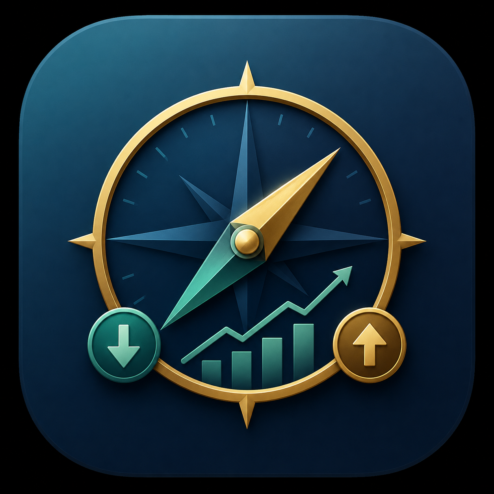

# Wealth Compass

<p align="center">
  
</p>

<p align="center">
  <a href="https://apps.apple.com/us/app/wealth-compass-tracker/id6777399748" target="_blank">
    
  </a>
</p>

Wealth Compass is a local-first net-worth tracker for **iPhone, iPad and Mac**. Cash, investments, crypto
and debts go in one place, on your device, and it works out what they add up to. It is free, one
universal App Store purchase covers every platform, there is no account to create, and Apple's privacy
label on the listing reads **Data Not Collected**.

The source is public but **not open source** — see [Licence](#-licence) below.

Built by [Simone Mattioli](https://simo-hue.github.io/) in Verona, Italy.
Product site: <https://simo-hue.github.io/wealth-compass/>

## 📱 Native Apple Applications

The core of Wealth Compass is a native Apple ecosystem implementation, ensuring secure, local-first tracking on your devices.

- **WealthCompassMobile**: Built with SwiftUI for iPhone and iPad, requiring iOS/iPadOS 17 or later. iPad runs the desktop-class sidebar UI rather than the iPhone tab bar.
- **WealthCompassMac**: Built with native SwiftUI for macOS 14 or later (built directly against the macOS SDK, not Mac Catalyst).

### Core Features
- 📊 **Interactive Dashboard**: Visual history of your net worth over time, asset allocation breakdowns, and key performance metrics.
- 💰 **Cash Flow Management**: Track income and expenses with categories, visual trends, and schedule recurring transaction reminders.
- 📈 **Investment Portfolio**: Real-time stock & ETF price updates via Finnhub and Yahoo Finance. Track cost basis, current value, and profit/loss.
- ₿ **Crypto Tracker**: Live data fetching from CoinGecko. Track crypto holdings and monitor live valuations.
- 🔒 **Privacy & Security**: All financial data is strictly stored locally in the app sandbox. Supports Face ID / Touch ID biometric locks and a quick-toggle Privacy Mode to blur sensitive amounts.
- 🌍 **Localization**: Localized into 35 languages via Xcode String Catalogs. Coverage varies by
  language — the core interface is translated throughout, while some newer surfaces (notably the PDF
  report vocabulary) still fall back to English.
- 🔄 **Data Portability**: Easily export your data to a JSON backup or import existing backups. Private CloudKit synchronization is available to keep your iPhone, iPad and Mac in sync.

### Building the Apple Apps

Open `apple/WealthCompass/WealthCompass.xcodeproj` and select:
- `WealthCompassMobile` for the iPhone and iPad app
- `WealthCompassMac` for the native macOS app

For architecture and detailed build instructions, see [`apple/README.md`](./apple/README.md).

## 📁 Repository Layout

The repository holds two independent implementations of the same product, one per platform. They
share the JSON backup format, but no code.

```text
wealth-compass/
├── apple/                       Native iOS, iPadOS and macOS apps — see apple/README.md
│   └── WealthCompass/
│       ├── Sources/Shared/      Domain code shared by every platform
│       ├── Sources/iOS/         iPhone application, views, and the iOS entry point
│       ├── Sources/Desktop/     Desktop-class UI — the Mac app, and what iPad runs
│       ├── Sources/macOS/       macOS-only lifecycle (entry point + app delegate)
│       ├── Resources/iOS/
│       ├── Resources/macOS/
│       └── WealthCompass.xcodeproj
├── web-app/                     Web application — see web-app/README.md
│   ├── src/                     React application source
│   ├── public/                  Web assets
│   └── package.json             Build, lint, and deploy scripts
├── DOCUMENTATION.md             Repo-wide change journal (both platforms)
└── TO_SIMO_DO.md                Repo-wide manual actions
```

---

## 🌐 `web-app/` — the product site, and the web app it grew out of

[`web-app/`](./web-app/) now contains two things in one Vite project:

**1. The product site** at <https://simo-hue.github.io/wealth-compass/> — the marketing site for the
Apple apps. It carries hand-built simulations of the iPhone and Mac apps, ported from the SwiftUI
source in [`apple/`](./apple/), which is why the two directories are coupled at build time (see below).

**2. The original web app**, under `/sw`, behind a lazy boundary. This is where the project started.
Unlike the local-first Apple apps it depends on a **centralized Supabase backend that you run
yourself**, and the deployed instance is single-tenant — gated to one email address — so it is source
to self-host, not a service to sign up for.

- **Tech Stack**: React, TypeScript, Vite, Tailwind CSS, shadcn/ui.
- **Backend & Auth** (the `/sw` app only): Supabase, with Row Level Security.
- **Deployment**: Manual — `cd web-app && npm run deploy` builds and publishes `dist/` to the
  `gh-pages` branch, which GitHub Pages serves. There is no CI workflow.

> **Build dependency:** `npm run build` reads `apple/WealthCompass/` for the app's locale count, its
> deployment targets and its version, so the figures on the site cannot silently go stale. Building
> `web-app/` from a checkout without the `apple/` tree will fail by design.

The build prerenders each marketing route to static HTML. That matters on GitHub Pages: a
client-routed SPA returns a 404 for any cold hit on a sub-path, which is what previously broke the
privacy and support URLs registered with Apple.

### Web App Installation
- [**Web App README**](./web-app/README.md)
- [**Installation Guide (English)**](./web-app/INSTALLATION.md)
- [**Guida all'Installazione (Italiano)**](./web-app/INSTALLATION_IT.md)

---

## 📄 Licence

**[PolyForm Noncommercial 1.0.0](./LICENSE)** — source-available, **not open source**.

The distinction is deliberate and worth stating plainly, because "open source" has a specific meaning
and this licence does not meet it. The [Open Source Definition](https://opensource.org/osd) requires
that a licence not restrict the field of endeavour; PolyForm Noncommercial restricts use to
noncommercial purposes, so it is not OSI-approved and the term does not apply.

What that means in practice:

| You can | You cannot |
|---|---|
| Read every line of the source | Use it for a commercial purpose |
| Build and run it yourself | Sell it, or sell a service built on it |
| Change it and redistribute your changes | Relicense it |
| Self-host the web app for personal use | |

GitHub reports this repository's licence as `NOASSERTION` because PolyForm is not in its SPDX set.
The authoritative text is [`LICENSE`](./LICENSE).

## 👤 Author

**Simone Mattioli** — Verona, Italy.
[Website](https://simo-hue.github.io/) · [GitHub](https://github.com/simo-hue) ·
[ORCID](https://orcid.org/0009-0006-5047-8004) ·
[Google Scholar](https://scholar.google.com/citations?user=uLGrDbIAAAAJ)

<p align="center">
  <span style="color: #666; font-size: 0.8em;">Wealth Compass &copy; 2026 Simone Mattioli</span>
</p>
